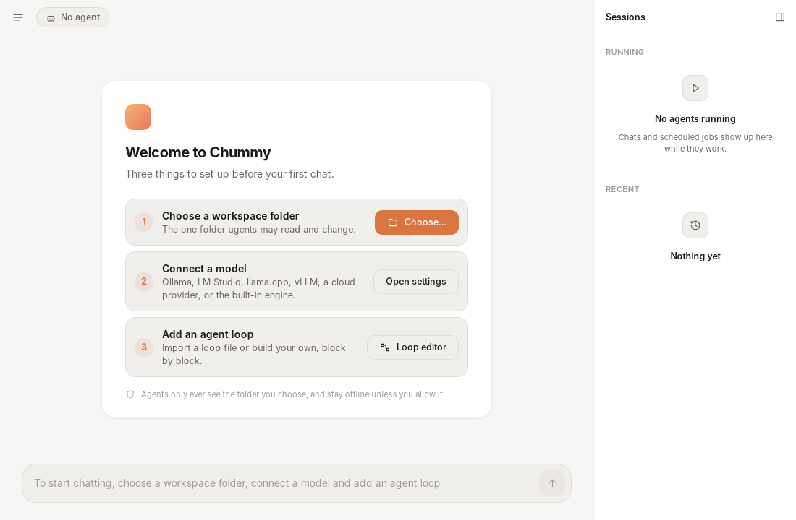
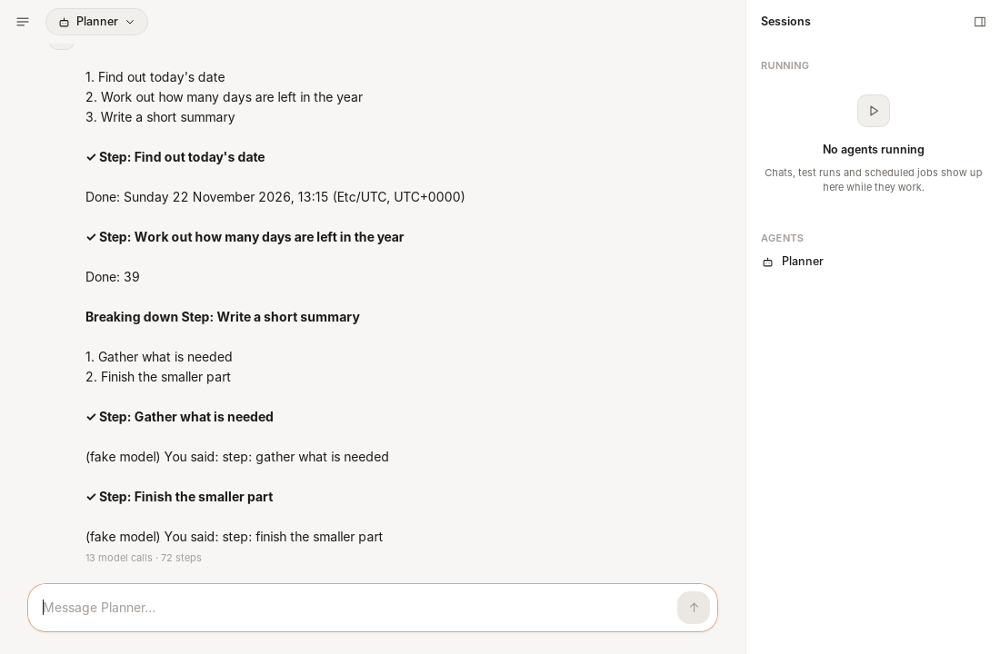
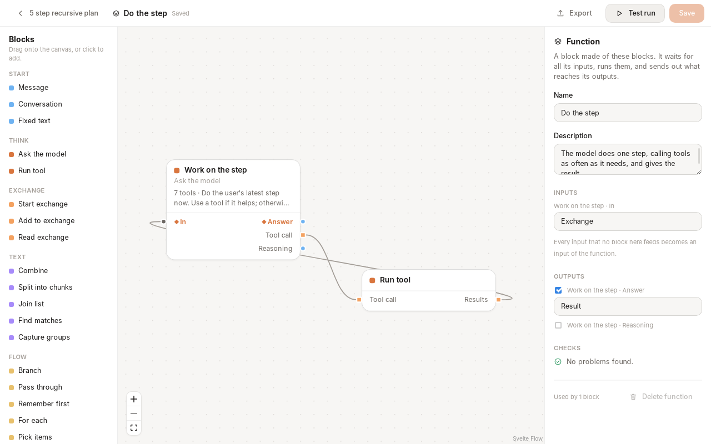

# Chummy

A minimalist, configurable agent harness for Windows, macOS and Linux.

Chummy assumes the model behind it may be small and easily confused. Agent
loops are built from small, editable blocks in a visual editor; every agent is
locked to one folder you choose; and nothing reaches the network or runs a tool
until you say so.



> **Status:** passes 1–4 of the roadmap are done: the app shell, the folder
> jail, settings, model connections (including a basic built-in engine), the
> loop engine and editor, agents and chat, sandboxed Python tools, exchanges,
> block functions, and the *5 step recursive plan* template. Next: the
> scheduler.



## What works today

- **Loops.** A loop is a directed graph of blocks that pass text along links,
  from your message to the agent's reply. A block waits until every input has
  a value, runs, and sends its result to everything linked to its outputs.
  Cycles are allowed (with step and model-call limits), so a loop can draft,
  check its own answer, and retry. The central block is **Ask the model**: a
  prompt of your own with `_INPUT_` where the block's input goes. Loops are
  plain JSON in a strict, versioned format: see
  [docs/loop-format.md](docs/loop-format.md).
- **Loop editor.** A node editor with a block palette, an inspector for every
  parameter, live checks, templates, import and export, and test runs that
  light up each block as it works.
- **Tools.** A tool is one Python file with a standard PEP 723 header. It runs
  as WebAssembly (CPython for WASI, under Wasmtime) and can see only the
  agent's workspace. It can't go online except through Chummy, and only if
  it asks for that, Internet access is on, and you allowed that tool. There
  is no unsandboxed mode. Dependencies come from a checksummed PEP 751 lock
  and must be pure Python. Seven built-in tools ship with Chummy: read,
  write, list and search files, calculator, current time, and fetch web page.
  See [docs/tool-format.md](docs/tool-format.md).
- **Model block with tools.** Ask the model has three outputs: **Answer**,
  **Tool call** (fires instead of Answer when the model calls a tool) and
  **Reasoning**. Each block picks its own tools, which keeps prompts short
  for small models. Bad calls (unknown tool, wrong arguments, no call when
  one is required) can be explained to the model and retried, stop the run,
  or fall back to the text. A **Run tool** block runs the calls and passes
  the results back.
- **Exchanges.** A conversation with the model that flows between blocks:
  *Start exchange*, *Add to exchange* and *Read exchange* build and read it,
  and model blocks continue it.
- **Block functions.** Select some blocks and choose **Make function**: they
  become one block whose ports are exactly the inputs and outputs you left
  open. Double-click to edit inside. Functions are saved in the loop file.
- **Templates.** Blank, Simple chat, Draft and self-check, **5 step
  recursive plan** and **5 step recursive plan verify**. The planner tries
  your goal straight away (by writing or with tools); anything too big is
  broken into 5 or fewer steps, and each step is tried the same way,
  breadth-first, with every result and plan shown as it goes. The verify
  version also has the model write a yes/no check question for each result
  and plan and answer it, breaking down results that fail and re-planning
  plans that fail.
- **Agents.** An agent is a loop, a model, and **its own workspace folder**.
  Each folder belongs to exactly one agent, and no agent's folder can be inside
  another's. Chat with an agent from the main window; its loop runs inside its
  folder, and progress shows live.
- **Workspace jail.** Each agent is locked to its folder, which you pick and
  confirm in a native dialog. Whole drives, your home folder, system folders, hidden
  settings folders (`.ssh`, `.config`, …) and Chummy's own folder are always
  refused, along with any folder that contains one of them. File access goes
  through a `cap-std` capability handle, so symlinks and junctions can't
  escape the folder.
- **Permissions.** Internet access and tools are off by default, and so is
  every tool, and every tool's internet access. Turning any of them on needs
  a native confirmation, shown by Rust, not by the web UI.
- **Model connections.** Ollama, LM Studio, llama.cpp, vLLM, any
  OpenAI-compatible server, OpenAI, Anthropic, Gemini, OpenRouter, Groq,
  Mistral, DeepSeek, xAI and Together. API keys live in the OS keychain. **Test
  connection** checks that the server is reachable, that the model replies,
  and whether it can call a tool.
- **Built-in engine (basic).** Paste a Hugging Face repo and Chummy checks it
  before downloading: it must be a text model, run without custom code, ship
  safetensors weights, and have a chat template with tools in a format Chummy
  can parse. The check shows the download size and estimated memory needs on
  common setups and on this computer. Downloads resume and are checksummed.
  Python, PyTorch (with the right CUDA, Metal or CPU build) and transformers
  are installed on first use with [uv](https://github.com/astral-sh/uv), inside
  Chummy's folder; none of them ship with the app. The engine is much slower
  than vLLM or llama.cpp, and the app says so.



<p>
  
  
</p>

## Where Chummy keeps things

| OS      | Chummy folder                                           |
|---------|---------------------------------------------------------|
| Linux   | `~/.local/share/com.friendlylabz.chummy`                |
| macOS   | `~/Library/Application Support/com.friendlylabz.chummy` |
| Windows | `%LOCALAPPDATA%\com.friendlylabz.chummy`                |

It holds `settings.json` (versioned, written atomically, with a `.bak`
backup), `loops/` (your loops, one JSON file each), `chats/` (chat history,
one file per agent), `models/`, `runtime/` (the built-in engine), `tools/`
(the WebAssembly Python and installed tools) and `logs/`.
Secrets are never stored here; they go to the system keychain (Keychain,
Credential Manager, or Secret Service on Linux). Set `HF_ENDPOINT` to use a
Hugging Face mirror.

## Development

**Prerequisites**

- [Rust](https://rustup.rs). The version is pinned in `rust-toolchain.toml`, and rustup installs it automatically.
- Node.js 22+
- Platform libraries:
  - **Linux:** `sudo apt install libwebkit2gtk-4.1-dev libayatana-appindicator3-dev librsvg2-dev libxdo-dev libssl-dev libdbus-1-dev build-essential`. Saving API keys at runtime needs a Secret Service provider (GNOME Keyring, KWallet).
  - **macOS:** Xcode Command Line Tools (`xcode-select --install`)
  - **Windows:** Microsoft C++ Build Tools and WebView2 (preinstalled on Windows 10/11)

**Run**

```sh
npm install
npm run tauri dev      # app with hot reload
npm run dev            # UI only, in a browser (IPC falls back to first-launch defaults)
```

**Build installers**

```sh
npm run tauri build    # MSI/NSIS · .dmg/.app · .deb/AppImage/.rpm
```

**Checks**

```sh
npm run check                                          # Svelte + TypeScript
cargo clippy --workspace --all-targets -- -D warnings
cargo test --workspace                                 # includes an end-to-end engine test (needs python on PATH)
python3 -m unittest discover -s crates/local/engine    # engine parsers and server
```

The sandbox tests run real tools on the real WebAssembly Python. Point them at
the archive (CI downloads it), and allow PyPI downloads for the tools with
dependencies:

```sh
curl -LO https://github.com/brettcannon/cpython-wasi-build/releases/download/v3.14.7/python-3.14.7-wasi_sdk-24.zip
CHUMMY_TEST_PYTHON_ZIP=$PWD/python-3.14.7-wasi_sdk-24.zip CHUMMY_TEST_PYPI=1 cargo test -p chummy-tools
```

Pushing a tag like `v0.1.0` runs `.github/workflows/release.yml`, which builds
installers for all platforms and attaches them to a draft GitHub release.

## Architecture

```
crates/          Pure Rust libraries, no Tauri dependency, tested on their own
  sandbox/       Workspace validation, protected locations, cap-std jail, grants
  llm/           Provider configs, adapters (OpenAI-compatible, Anthropic, Gemini), probe
  local/         Built-in engine: HF inspection, estimates, downloads, runtime, process
    engine/      chummy_engine.py: the OpenAI-compatible transformers server
  store/         Chummy folder layout, atomic versioned JSON, keychain secrets
  flow/          Loop format, block catalog, validation, the loop engine, templates
    templates/   Template loop files (the 5 step recursive plan)
  tools/         Python tools as WebAssembly: format, locks, installer, sandbox host
    builtin/     The built-in tools and their pylock files
    support/     The in-sandbox runner and the `chummy` helper module
  scheduler/     Jobs, triggers, input sources
src-tauri/       Thin app shell: state, IPC commands, native dialogs, windows
  capabilities/  One permission file per window
ui/              Svelte 5 frontend, one Vite page per window
  index.html     Main window: chat, menu, sessions panel
  editor.html    Loop editor (xyflow)
  settings.html  Settings
  scheduler.html Scheduler and dispatch
  src/lib/ipc.ts The only file that talks to Rust
```

**Loop pipeline:** chat message → `send_message` → the agent's loop file is
checked → its workspace is opened as a `Jail` → `chummy_flow::run` executes the
blocks, calling models through the model pipeline and touching files only
through the jail → `run:*` events stream to every window → the replies are
saved to the agent's chat history. Block ports come from the Rust catalog; the
editor asks Rust for them (`analyze_loop`), so there's a single source of truth.

**Model pipeline:** `ProviderConfig` → `Client` → adapter → server-sent events →
`ChatEvent` (`Text`, `Reasoning`, `ToolCall`, `MalformedToolCall`, `Done`). Tool
calls are fully assembled and parsed before they're emitted. Invalid arguments
come back as `MalformedToolCall` with the raw text, so a verification step can
ask the model to fix them. The built-in engine is just another
OpenAI-compatible endpoint (127.0.0.1, random bearer token, offline).

**Rules of the road**

- Rust is the source of truth and the only place sandbox decisions are made.
  Windows read state through commands and hear about changes through events.
- The UI never sends a filesystem path to Rust for a workspace: Rust shows
  the picker, validates the choice, asks for confirmation, and hands back a
  one-time token that stands for the folder.
- Each window only gets the commands it needs (`src-tauri/capabilities/`).
- Adding a command: implement it in `src-tauri/src/commands/`, register it in
  `lib.rs`, list it in `build.rs`, allow it in the relevant capability files,
  and add a typed wrapper in `ui/src/lib/ipc.ts`.
- Adding a window: add an HTML page in `ui/`, an entry in `vite.config.ts`, a
  variant in `src-tauri/src/windows.rs` and a capability file.
- Settings schema changes: add a field with a default, or bump `VERSION` and add
  a migration step in `src-tauri/src/settings.rs`.
- Themes are sets of CSS variables (`ui/src/theme/`); components use only those
  variables.

## Roadmap

1. **Skeleton & build system.** Done.
2. **Sandbox, settings, models.** Done.
3. **Loop engine & editor.** Done.
4. **Tools, exchanges, functions.** Done.
5. **Scheduler.** Scheduled jobs with file, web, folder-watch and timer
   inputs, running agents' loops.

## License

[MIT](LICENSE) © 2026 friendlylabz. The built-in engine downloads third-party
open-source software at runtime (uv, CPython, PyTorch, transformers and their
dependencies) under their own licenses; none of it is bundled with Chummy.
Tools likewise download the CPython WASI build (PSF license) and their
packages from PyPI at setup.
