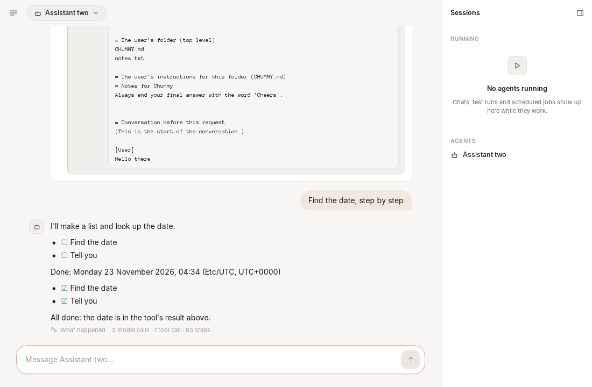
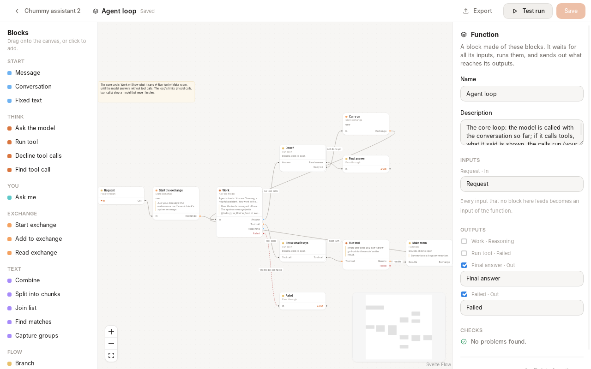
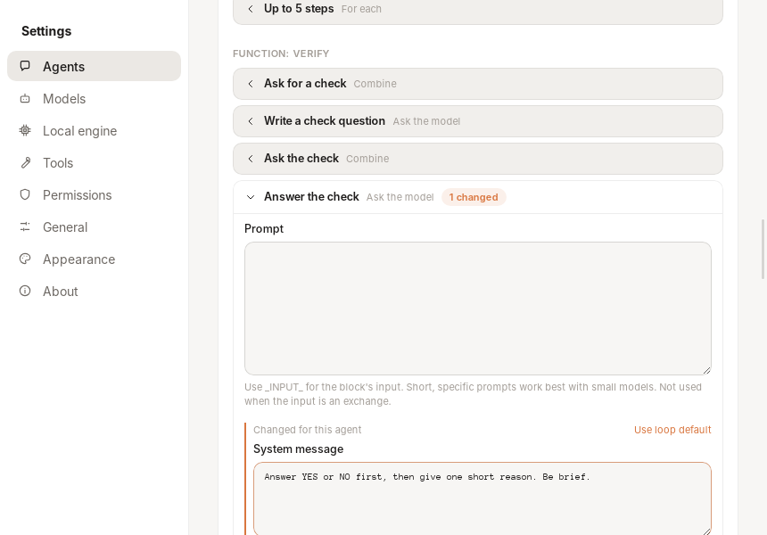
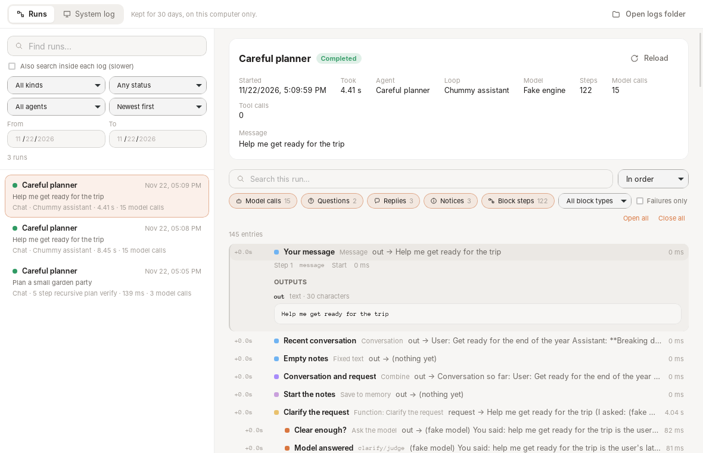
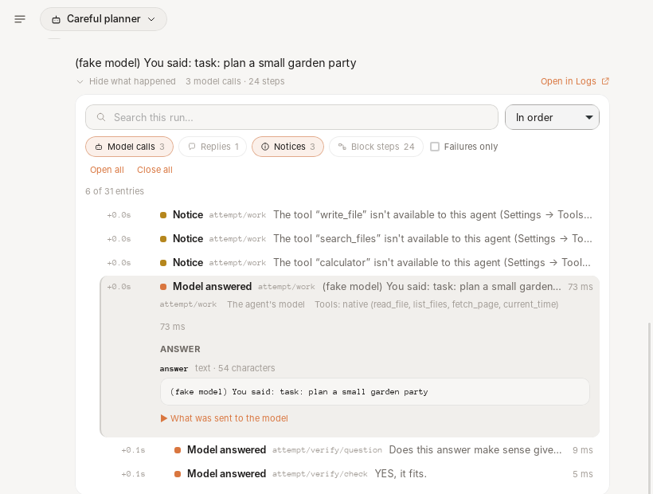
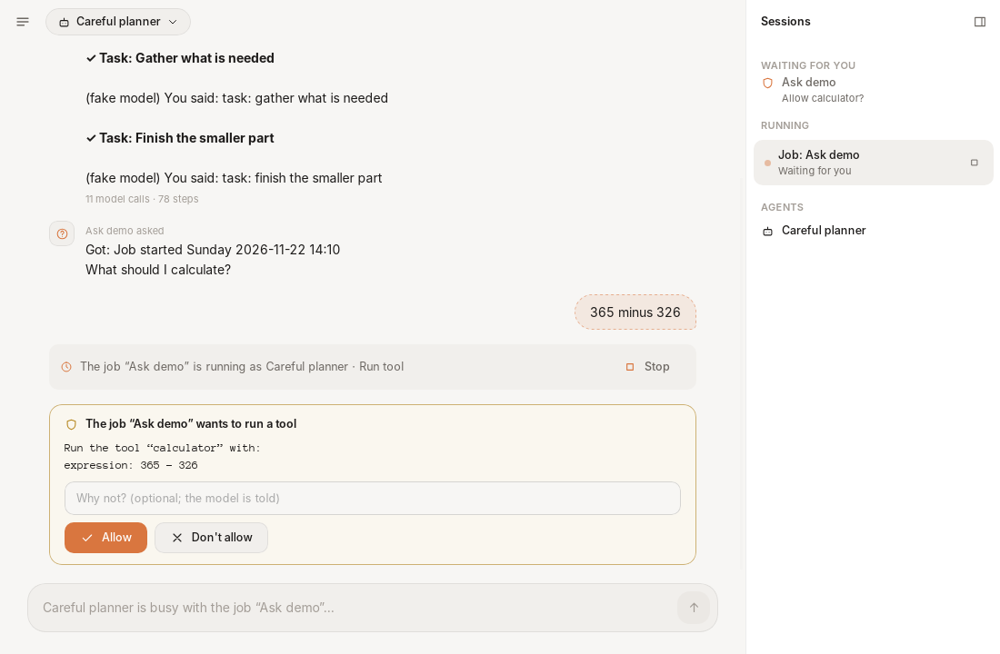
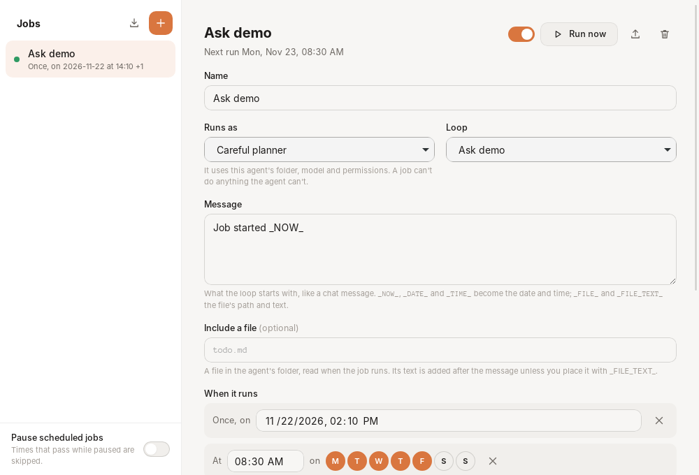
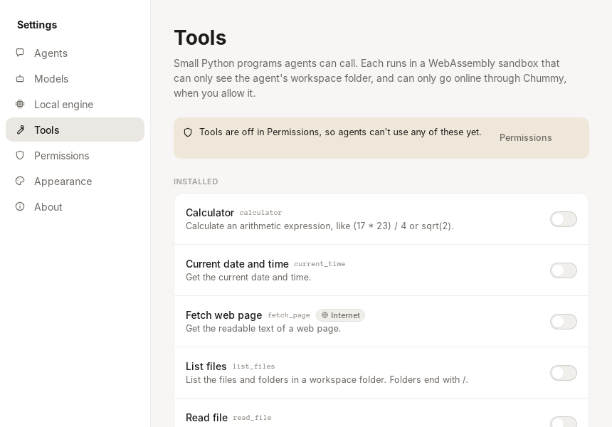
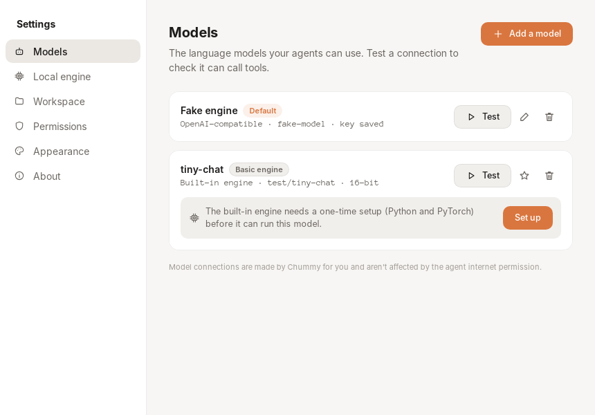

# Chummy

> [!WARNING]
> **Chummy is a heavy work in progress, and 100% vibe-coded:** every line was
> written by an AI (Claude) at a person's direction. Expect rough edges, bugs
> and breaking changes between versions. Try it on folders you don't mind an
> agent changing, and keep backups.

A minimalist, configurable agent harness for Windows, macOS and Linux.

## Download

Get the latest build from the [Releases page](https://github.com/friendlylabz/Chummy/releases):

| System | File | Notes |
|---|---|---|
| **Windows** | `Chummy_…_x64-setup.exe` | Windows may say it "protected your PC" because the app isn't signed yet: click **More info → Run anyway**. (There's also an `.msi`.) |
| **macOS** (Apple Silicon: M1 and newer) | `Chummy_…_aarch64.dmg` | Open it and drag Chummy to Applications. The app isn't notarized yet, so the first time, macOS will refuse to open it: go to **System Settings → Privacy & Security**, scroll down, and click **Open Anyway** (or right-click the app → Open). |
| **macOS** (Intel) | `Chummy_…_x64.dmg` | As above. |
| **Linux** | `Chummy_…_amd64.AppImage` | Make it runnable (`chmod +x Chummy_*.AppImage`, or Properties → Permissions) and open it. Some distributions need `libfuse2` for AppImages. There are also `.deb` and `.rpm` packages. |

The first time it opens, Chummy walks you through connecting a model (for
example [Ollama](https://ollama.com) or [LM Studio](https://lmstudio.ai) on
your computer, or a cloud provider), adding the recommended loop and setting
up an agent with its own folder.

Chummy assumes the model behind it may be small and easily confused. Agent
loops are built from small, editable blocks in a visual editor; every agent is
locked to one folder you choose; and nothing reaches the network or runs a tool
until you say so.


> **Status:** passes 1–14 of the roadmap are done: the app shell, the folder
> jail, settings, model connections (including a basic built-in engine), the
> loop engine and editor, agents and chat, sandboxed Python tools, exchanges,
> block functions, the scheduler with tray mode and questions for you, and
> the default **Chummy assistant** loop (one agent loop with its own to-do list) with tool modes,
> failure outputs, daily token limits and per-agent settings, and logs of
> every run (each block's inputs and outputs) plus a system log, viewable in
> the app and under each chat message, and a choice of sandbox for tools
> (WebAssembly, containers or NVIDIA OpenShell). Next: chummyd,
> an optional background service ([plan](docs/chummyd-plan.md)).



## What works today

- **Loops.** A loop is a directed graph of blocks that pass text along links,
  from your message to the agent's reply. A block waits until every input has
  a value, runs, and sends its result to everything linked to its outputs.
  Cycles are allowed (with step and model-call limits), so a loop can draft,
  check its own answer, and retry. The central block is **Ask the model**: a
  prompt of your own with `_INPUT_` where the block's input goes. Loops are
  plain JSON in a strict, versioned format: see
  [docs/loop-format.md](docs/loop-format.md).
- **Loop editor.** A node editor with a block palette, an inspector for every
  parameter, live checks, templates, import and export, and test runs that
  light up each block as it works. Blocks can carry a **comment**, links a
  **label**, and the canvas **notes**, all saved in the loop file so a loop
  explains itself.
- **Tools.** A tool is one Python file with a standard PEP 723 header. It can
  see only the agent's workspace and can't go online except through Chummy,
  and only if it asks for that, Internet access is on, and you allowed that
  tool. There is no unsandboxed mode. Dependencies come from a checksummed
  PEP 751 lock and must be pure Python. Eleven built-in tools ship with
  Chummy: read (in chunks, by line), write, edit (exact text replacement,
  like Claude Code's Edit), list, search (grep-like) and find files,
  calculator, current time, fetch web page, **run command**, a small shell
  (pipes, redirects, common commands, `python`) that works in every sandbox,
  and **run shell**, a real `sh -c` for the sandboxes that have programs.
  Both are marked *potentially unsafe*: they ask before they're switched on
  and before each use.
- **Sandboxes.** You choose where tool calls run, in Settings → Security and
  Privacy: **Native** (the default: CPython for WebAssembly under Wasmtime,
  built in, nothing to install), **Container** (a fresh, locked-down Docker
  or Podman container per call, with no network, running exactly the image
  you approved) or **NVIDIA OpenShell** (Landlock-enforced sandboxes with no
  network; the workspace is copied in and out). Tools the chosen sandbox
  can't run are greyed out with the reason. See
  [docs/sandboxes.md](docs/sandboxes.md).
  See [docs/tool-format.md](docs/tool-format.md).
- **Model block with tools.** Ask the model has outputs **Answer**,
  **Tool call** (fires instead of Answer when the model calls a tool),
  **Reasoning** and **Failed**. Each block uses the agent's tools and can
  disable some or all of them (never turn more on), which keeps prompts short
  for small models. **Tool handling** is *Native* (the
  server's tool calling, the default), *Prompted* (tools described in the
  system message and calls parsed from the text, for models or servers
  without tool calling) or *Off* (the loop handles tools itself with
  `_TOOLS_` in a prompt and a **Find tool call** block). Bad calls (unknown tool, wrong arguments, no call when
  one is required) can be explained to the model and retried, stop the run,
  or fall back to the text. A **Run tool** block runs the calls and passes
  the results back.
- **Failures you can route.** Blocks that can fail (model, Run tool, Ask me
  and the file blocks) have a **Failed** output carrying the error message.
  Link it and the loop carries on; leave it unlinked and the failure stops
  the run as before.
- **Working notes.** **Save to memory** and **Read memory** blocks keep text
  under a name for the rest of the run, and any prompt can include it with
  `{{name}}`. The assistant uses this to keep notes that every model call
  sees and that the model updates after each step.
- **Daily token limits.** Each model connection has a daily limit (1,000,000
  tokens by default, or off), shown with today's use in Settings → Models.
  When it runs out, each model block waits until midnight, stops the run, or
  asks you for more, as you choose.
- **Logs.** Every run of a loop (chat, job or test) is logged: each block
  it executed with its inputs and outputs (functions included, nested),
  every model call with what was sent, the reasoning and the answer, and
  every tool call, question, notice and reply. Chummy also keeps a system
  log of what it did: starts, settings and permission changes, runs, jobs,
  tools, questions and errors (never message text, files or keys). The
  **Logs** window (main menu → Logs) finds runs by text, kind, status, agent
  and date, searches inside logs, and sorts them; within a run you can
  search, show or hide each kind of entry, pick block types, show only
  failures, and sort by order or time taken. Logs are kept for 30 days.
- **Encrypted logs.** Run logs can hold anything that passed through a run,
  so by default every line is sealed with XChaCha20-Poly1305 under a 256-bit
  key made on first use and kept in the OS keychain. Export the key (main
  menu or Settings → Logs) to a file locked with a passphrase (Argon2id), and
  import it on another computer to read the logs there. Settings → Logs sets
  run logs to everything, shortened, steps only or off, turns encryption
  off (after a warning), and sets the system log's level, down to off.
- **Formatted replies.** Replies show Markdown (headings, lists, task lists,
  quotes, tables, code blocks with a Copy button, emphasis, links) and LaTeX
  math via KaTeX ($…$, $$…$$, \(…\), \[…\]; “$5 and $10” stays money).
  Model text is escaped before any formatting, links ask before opening, and
  both can be turned off in Settings → Appearance.
- **What happened, under each reply.** Every reply in chat has a collapsed
  **What happened** view of that run: the model's reasoning and answers,
  tool calls and questions, and (one click) every block step, with the same
  search and filters. It follows a run live while it works.
- **Exchanges.** A conversation with the model that flows between blocks:
  *Start exchange*, *Add to exchange* and *Read exchange* build and read it,
  and model blocks continue it.
- **Block functions.** Select some blocks and choose **Make function**: they
  become one block whose ports are exactly the inputs and outputs you left
  open. Double-click to edit inside. Functions are saved in the loop file.
- **Chummy assistant (the default).** One agent loop, like a coding
  agent's: the model works with tools, call after call, until it answers
  without one. It says what it's doing as it goes, keeps its own to-do list
  (a checklist it rewrites as it works) for bigger jobs, reads `CHUMMY.md`
  from the agent's folder for your instructions, and summarises the
  conversation when it gets long. If it stops with steps unchecked or with
  an empty answer, it's sent back to finish (twice at most). Onboarding
  offers it with one click, and a first agent gets it automatically.
- **Templates.** Chummy assistant, Blank (a Message and a Reply block) and
  Simple chat (one model call with the conversation as context).
- **Scheduled jobs.** A job runs one of your agents with a message: at set
  times, every so often, once, or when files land in a folder of the
  agent's. It runs with exactly that agent's folder, model and permissions.
  Jobs can include a file, save their reply to a file, have a time limit,
  catch up on times missed while Chummy was closed, and keep a history of
  their runs. See [docs/job-format.md](docs/job-format.md).
- **Questions for you.** An **Ask me** block asks you something in chat and
  waits for your answer; a **Run tool** block can wait for your OK before
  each call. Scheduled jobs ask in the agent's chat and the Scheduler, and
  Chummy sends a notification. Tools that can go online always ask first,
  unless you turn that off.
- **Tray mode.** Chummy's icon stays in the tray while it runs. Closing the
  window asks whether to quit (stopping everything) or keep running in the
  tray so jobs carry on; you can make either the default.
- **Agents.** An agent is a loop, a model, and **its own workspace folder**.
  Each folder belongs to exactly one agent, and no agent's folder can be inside
  another's. Chat with an agent from the main window; its loop runs inside its
  folder, and progress shows live. Each agent has its own **tool and internet
  switches**, and **Agent Loop Configuration** changes any block's settings
  for that agent alone, without touching the loop file. Those settings can be
  exported and imported as `chummy.loopconfig` files.
- **Chats.** Each agent has as many chats as you like, saved as they happen.
  The chat picker next to the agent picker starts a **New chat** or opens an
  earlier one (newest first; a dot marks chats that are working). An agent's
  chats run side by side, one message at a time each; a scheduled job or a
  test run of the same agent waits for them, and they wait for it. The
  Sessions panel shows which chat each run belongs to, and clicking it opens
  that chat. A new agent starts with an empty chat. Click the trash can
  under a message, then **Delete**, to delete it: it's gone from the
  chat and from what the agent sees next time (not while that chat is
  working). **Undo** brings it back where it was, for 20 seconds or until you
  send another message.
- **Workspace jail.** Each agent is locked to its folder, which you pick and
  confirm in a native dialog. Whole drives, your home folder, system folders, hidden
  settings folders (`.ssh`, `.config`, …) and Chummy's own folder are always
  refused, along with any folder that contains one of them. File access goes
  through a `cap-std` capability handle, so symlinks and junctions can't
  escape the folder.
- **Security and Privacy.** Internet access and tools are off by default, and so is
  every tool, and every tool's internet access. Turning any of them on needs
  a native confirmation, shown by Rust, not by the web UI. A tool runs only
  when it's on at every level: app-wide, for the agent, and in the block. See
  [docs/security.md](docs/security.md) for the threat model and the latest
  audit.
- **Answer length per model.** Each model connection has a longest answer
  (1,024 tokens to start), used by every model block that doesn't set its
  own; a block can override it in the editor or Agent Loop Configuration.
- **Model connections.** Ollama, LM Studio, llama.cpp, vLLM, any
  OpenAI-compatible server, OpenAI, Anthropic, Gemini, OpenRouter, Groq,
  Mistral, DeepSeek, xAI and Together. API keys live in the OS keychain. **Test
  connection** checks that the server is reachable, that the model replies,
  whether it can call a tool, and how long its context is (most servers
  report it; OpenAI's own API doesn't). Each connection has a context length
  (the reported one, or less if you set it) and a *Make room at* point (80%
  of the context by default), where the Chummy assistant summarises a long
  conversation. **Use model within app** (off by default) is the only way
  Chummy calls a model outside your loops: with it on, Chummy also uses that
  model for small jobs of its own, like naming chats from their first reply;
  with it off, chats are named from your first message.
- **Turn figures.** Under each reply: model calls, tool calls and steps, then
  the tokens the turn added to context, how full the context is, and how
  much of the model's daily token limit is used (all estimates).
- **Built-in engine (basic).** Paste a Hugging Face repo and Chummy checks it
  before downloading: it must be a text model, run without custom code, ship
  safetensors weights, and have a chat template with tools in a format Chummy
  can parse. The check shows the download size and estimated memory needs on
  common setups and on this computer. Downloads resume and are checksummed.
  Python, PyTorch (with the right CUDA, Metal or CPU build) and transformers
  are installed on first use with [uv](https://github.com/astral-sh/uv), inside
  Chummy's folder; none of them ship with the app. The engine is much slower
  than vLLM or llama.cpp, and the app says so.










<p>
  
  
</p>

<p>
  
  
</p>

## Where Chummy keeps things

| OS      | Chummy folder                                           |
|---------|---------------------------------------------------------|
| Linux   | `~/.local/share/com.friendlylabz.chummy`                |
| macOS   | `~/Library/Application Support/com.friendlylabz.chummy` |
| Windows | `%LOCALAPPDATA%\com.friendlylabz.chummy`                |

It holds `settings.json` (versioned, written atomically, with a `.bak`
backup), `loops/` (your loops, one JSON file each), `chats/` (chat history:
a folder per agent with an index and one file per chat), `jobs/` (scheduled jobs, their state and run history),
`usage.json` (tokens used per model per day, kept 31 days), `logs/system/`
(the system log, one file a day) and `logs/runs/` (one log per run, by day),
`models/`,
`runtime/` (the built-in engine), `tools/` (the WebAssembly Python
and installed tools) and `logs/`.
Chummy keeps the folder private to your user account: on macOS and Linux it
makes the folder 700 and everything in it 600 (keeping the owner's execute bit
for programs), and checks again every time it starts. On Windows the default
folder is inside your user profile, which is already private to you.

To use another folder, start Chummy with `--data-dir <folder>` (or
`--data-dir=<folder>`); a relative path is taken from the current folder. It
must be empty, new, or an existing Chummy folder, so Chummy never takes over
a folder with other things in it. Settings → Security and Privacy shows which
folder is in use.

Secrets are never stored here; they go to the system keychain (Keychain,
Credential Manager, or Secret Service on Linux). Set `HF_ENDPOINT` to use a
Hugging Face mirror.

## Development

**Prerequisites**

- [Rust](https://rustup.rs). The version is pinned in `rust-toolchain.toml`, and rustup installs it automatically.
- Node.js 22+
- Platform libraries:
  - **Linux:** `sudo apt install libwebkit2gtk-4.1-dev libayatana-appindicator3-dev librsvg2-dev libxdo-dev libssl-dev libdbus-1-dev build-essential`. Saving API keys at runtime needs a Secret Service provider (GNOME Keyring, KWallet).
  - **macOS:** Xcode Command Line Tools (`xcode-select --install`)
  - **Windows:** Microsoft C++ Build Tools and WebView2 (preinstalled on Windows 10/11)

**Run**

```sh
npm install
npm run tauri dev      # app with hot reload
npm run dev            # UI only, in a browser (IPC falls back to first-launch defaults)
```

**Build installers**

```sh
npm run tauri build    # MSI/NSIS · .dmg/.app · .deb/AppImage/.rpm
```

**Checks**

```sh
npm run check                                          # Svelte + TypeScript
cargo clippy --workspace --all-targets -- -D warnings
cargo test --workspace                                 # includes an end-to-end engine test (needs python on PATH)
python3 -m unittest discover -s crates/local/engine    # engine parsers and server
```

The sandbox tests run real tools on the real WebAssembly Python. Point them at
the archive (CI downloads it), and allow PyPI downloads for the tools with
dependencies:

```sh
curl -LO https://github.com/brettcannon/cpython-wasi-build/releases/download/v3.14.7/python-3.14.7-wasi_sdk-24.zip
CHUMMY_TEST_PYTHON_ZIP=$PWD/python-3.14.7-wasi_sdk-24.zip CHUMMY_TEST_PYPI=1 cargo test -p chummy-tools
```

Pushing a tag like `v0.1.0` runs `.github/workflows/release.yml`, which builds
installers for all platforms and attaches them to a draft GitHub release.

## Architecture

```
crates/          Pure Rust libraries, no Tauri dependency, tested on their own
  sandbox/       Workspace validation, protected locations, cap-std jail, grants
  llm/           Provider configs, adapters (OpenAI-compatible, Anthropic, Gemini), probe
  local/         Built-in engine: HF inspection, estimates, downloads, runtime, process
    engine/      chummy_engine.py: the OpenAI-compatible transformers server
  store/         Chummy folder layout, atomic versioned JSON, keychain secrets
  flow/          Loop format, block catalog, validation, the loop engine, templates
    templates/   The Chummy assistant's loop file and its generator (make_templates.py, assistant.py)
  tools/         Python tools: format, locks, installer, sandboxes (Wasm, container, OpenShell)
    builtin/     The built-in tools and their pylock files
    support/     The in-sandbox runner and the `chummy` helper module
  scheduler/     Jobs, triggers, the run planner, folder watching, history, questions
  runner/        Runs an agent: models, tools, jail, questions; shared with chummyd
  log/           The system log and run logs (JSON lines), encryption, search and retention
src-tauri/       Thin app shell: state, IPC commands, native dialogs, windows
  capabilities/  One permission file per window
ui/              Svelte 5 frontend, one Vite page per window
  index.html     Main window: chat, menu, sessions panel
  editor.html    Loop editor (xyflow)
  settings.html  Settings
  scheduler.html Scheduler: jobs, schedules, runs
  logs.html      Logs: run logs and the system log
  src/lib/ipc.ts The only file that talks to Rust
```

**Loop pipeline:** chat message → `send_message` → the agent's loop file is
checked → its workspace is opened as a `Jail` → `chummy_flow::run` executes the
blocks, calling models through the model pipeline and touching files only
through the jail → `run:*` events stream to every window → the replies are
saved to the chat the message came from. Block ports come from the Rust catalog; the
editor asks Rust for them (`analyze_loop`), so there's a single source of truth.

**Job pipeline:** `chummy_scheduler::Manager` checks schedules and watched
folders every few seconds, queues what's due (one run per job and per agent,
missed times skipped or caught up once), and starts runs through a
`JobRunner`. The app's runner opens the agent's jail and runs the loop with
`chummy_runner::run_job`, exactly as a chat would. Questions from any run go
through one `AskBroker` and are answered from the app's windows. None of this
depends on Tauri, so chummyd can reuse it.

**Model pipeline:** `ProviderConfig` → `Client` → adapter → server-sent events →
`ChatEvent` (`Text`, `Reasoning`, `ToolCall`, `MalformedToolCall`, `Done`). Tool
calls are fully assembled and parsed before they're emitted. Invalid arguments
come back as `MalformedToolCall` with the raw text, so a verification step can
ask the model to fix them. The built-in engine is just another
OpenAI-compatible endpoint (127.0.0.1, random bearer token, offline).

**Rules of the road**

- Rust is the source of truth and the only place sandbox decisions are made.
  Windows read state through commands and hear about changes through events.
- The UI never sends a filesystem path to Rust for a workspace: Rust shows
  the picker, validates the choice, asks for confirmation, and hands back a
  one-time token that stands for the folder.
- Each window only gets the commands it needs (`src-tauri/capabilities/`).
- Adding a command: implement it in `src-tauri/src/commands/`, register it in
  `lib.rs`, list it in `build.rs`, allow it in the relevant capability files,
  and add a typed wrapper in `ui/src/lib/ipc.ts`.
- Adding a window: add an HTML page in `ui/`, an entry in `vite.config.ts`, a
  variant in `src-tauri/src/windows.rs` and a capability file.
- Settings schema changes: add a field with a default, or bump `VERSION` and add
  a migration step in `src-tauri/src/settings.rs`.
- Themes are sets of CSS variables (`ui/src/theme/`); components use only those
  variables.

## Roadmap

1. **Skeleton & build system.** Done.
2. **Sandbox, settings, models.** Done.
3. **Loop engine & editor.** Done.
4. **Tools, exchanges, functions.** Done.
5. **Scheduler, tray mode, questions for you, security audit.** Done.
6. **Default assistant loop, tool modes, failure outputs, working notes,
   daily token limits, per-agent switches and loop configuration, editor
   comments and notes.** Done.
7. **Logs: run logs with every block's inputs and outputs, the system log,
   the Logs window, step views in chat, and the whole plan in the
   assistant's output.** Done.
8. **Formatted replies (Markdown and math), encrypted and configurable logs
   with an exportable key, and answer length per model.** Done.
9. **Inherited settings: tools follow the app and the agent, with an
   inherit / on / off override per block (since v0.1.1 blocks can only turn tools off); answer length and temperature
   follow the model unless a block sets them. Blank clarifying questions
   fixed.** Done.
10. **A new default assistant: one go if it can, otherwise the whole plan
    first (depth first, two levels, 10 steps), then each step with 5 checked
    tries, stopping with a reason if one can't be done.** Done.
11. **The Chummy assistant rebuilt as one agent loop with its own to-do list,
    context lengths and compaction.** Done.
12. **Several chats per agent.** Done.
13. **Better built-in tools: chunked reading, exact edits, search, find, and
    a sandboxed command line.** Done.
14. **Choice of sandbox (Native, Container or NVIDIA OpenShell), Security and
    Privacy with optional onboarding steps, tools greyed out when the
    sandbox can't run them, and a real-shell tool.** Done.
15. **chummyd.** An optional, separately installed background service for jobs,
   with an authenticated API, configured from the app. See
   [docs/chummyd-plan.md](docs/chummyd-plan.md).

## License

[MIT](LICENSE) © 2026 friendlylabz. The built-in engine downloads third-party
open-source software at runtime (uv, CPython, PyTorch, transformers and their
dependencies) under their own licenses; none of it is bundled with Chummy.
Tools likewise download the CPython WASI build (PSF license) and their
packages from PyPI at setup.
